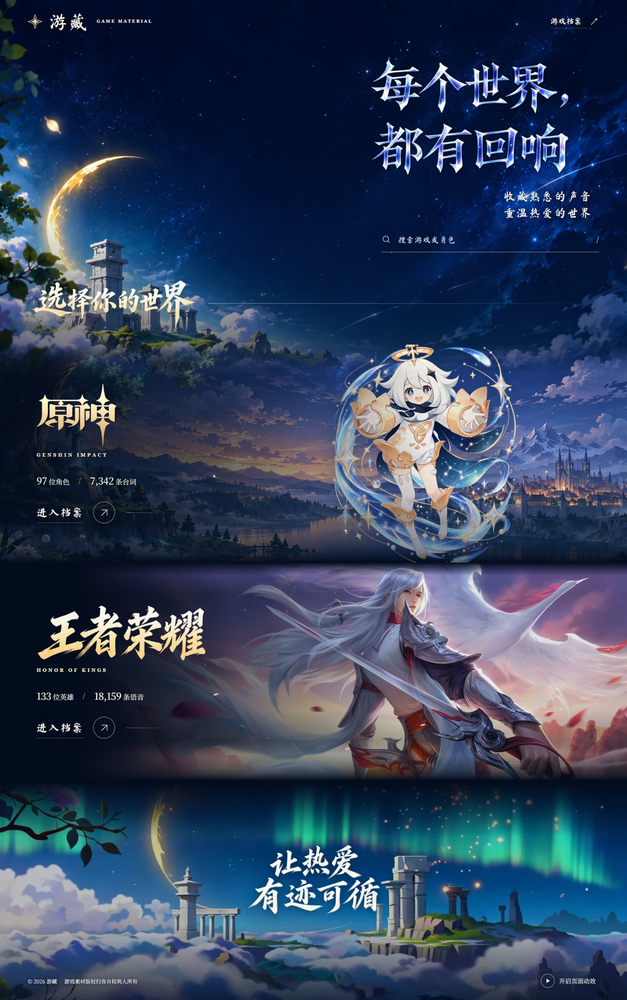
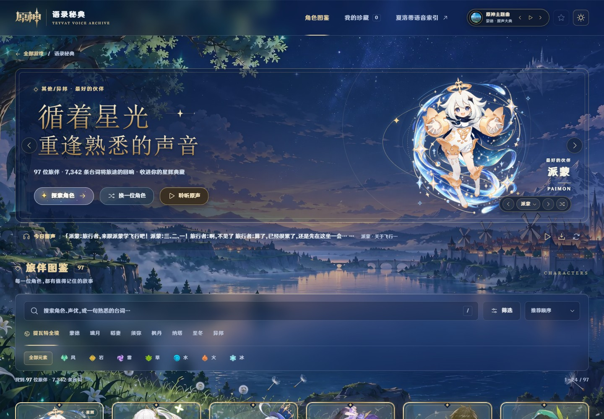
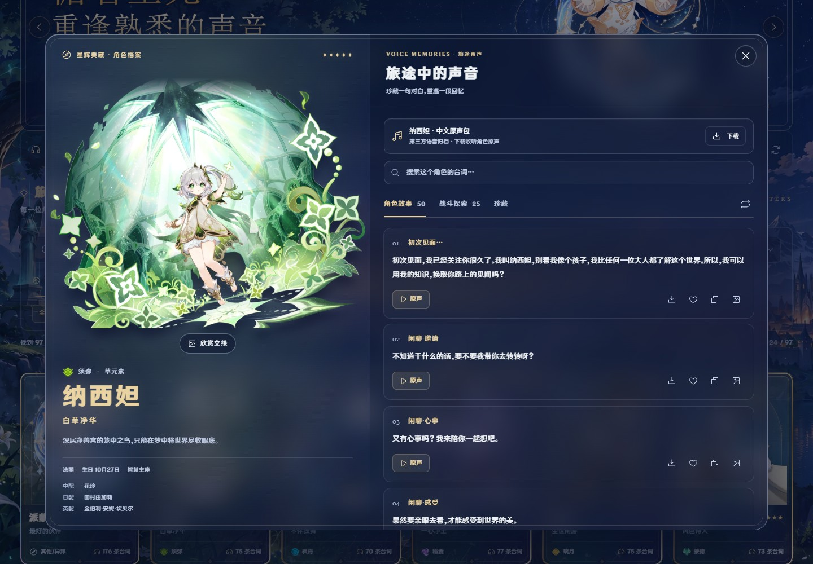
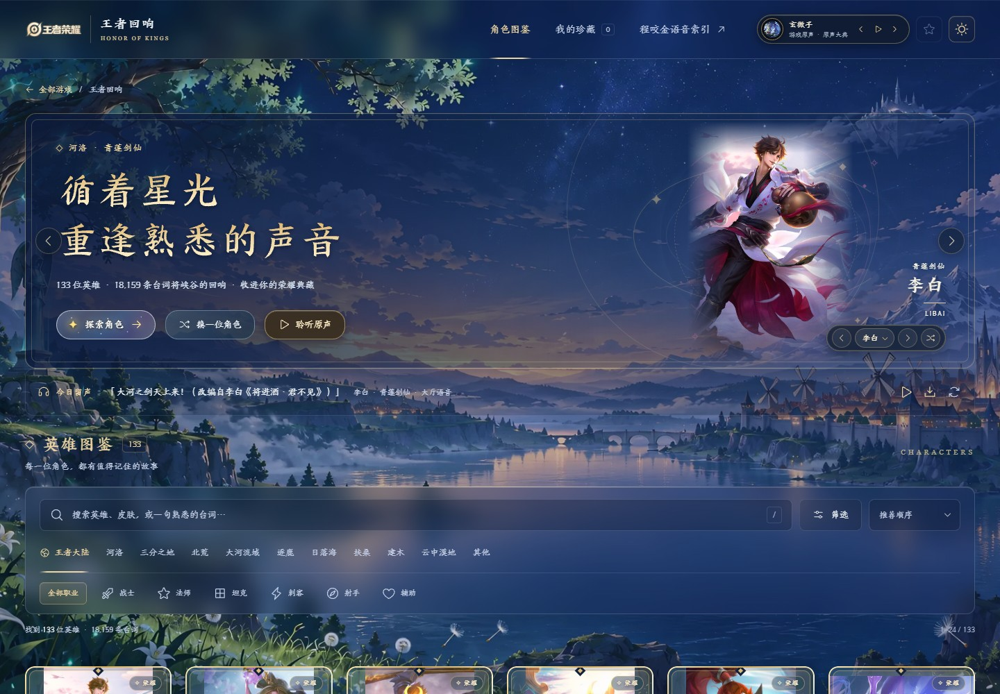
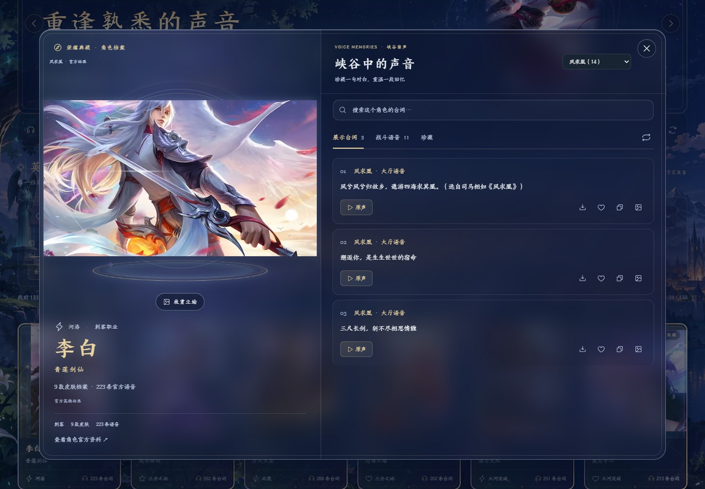
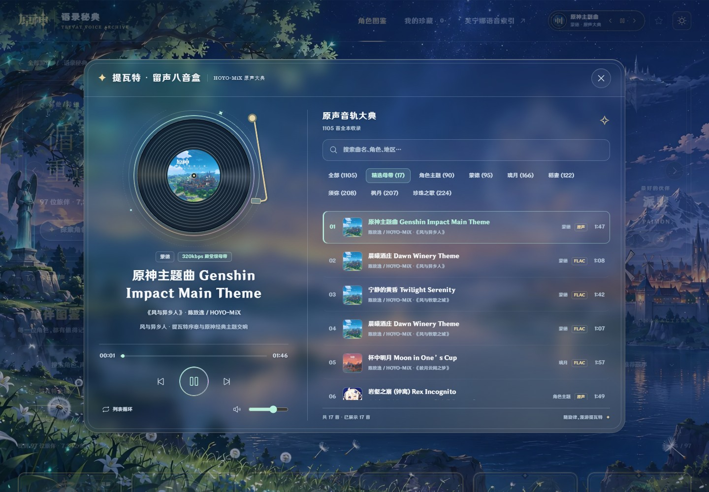
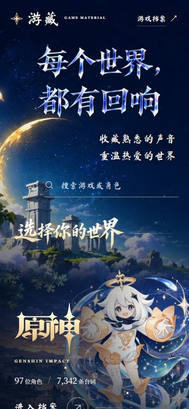
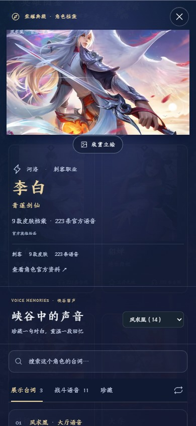
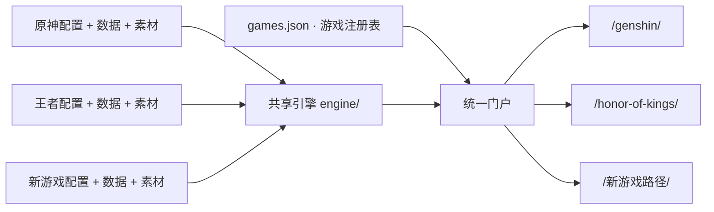

<div align="center">

# 游藏 · GameMaterial

**每个世界，都有回响。**

收藏熟悉的声音，重温热爱的世界。一个汇集游戏角色、台词、语音与音乐的同人档案站。


[进入游藏](https://gamematerial.yzzwnw.asia/) · [原神档案](https://gamematerial.yzzwnw.asia/genshin/) · [王者荣耀档案](https://gamematerial.yzzwnw.asia/honor-of-kings/)

[界面预览](#界面预览) · [快速开始](#快速开始) · [项目结构](#项目结构) · [接入新游戏](#接入新游戏) · [构建与部署](#构建与部署)

</div>



## 项目介绍

GameMaterial 将多个游戏的声音档案放进同一个入口：先选择世界，再浏览角色，寻找一句熟悉的台词，或打开音乐盒重温游戏原声。

目前已接入 **原神** 和 **王者荣耀**，共收录 **230 位角色 / 英雄、25,501 条台词与 2,454 条音乐目录记录**。各游戏共用页面、搜索、详情、收藏与播放器，通过配置和数据保留各自的品牌、分类、立绘与声音。

### 当前收录

| 游戏 | 角色 / 英雄 | 台词条目 | 音乐目录 | 主要内容 |
| --- | ---: | ---: | ---: | --- |
| 原神 | 97 | 7,342 | 1,105 | 角色故事、战斗探索、声优资料、语音索引与原声音乐 |
| 王者荣耀 | 133 | 18,159 | 1,349 | 英雄档案、皮肤筛选、展示台词、战斗语音与主题音乐 |

统计来自仓库内的角色与音乐数据，核对日期为 **2026-10-26**。台词和音乐目录条目包含本地素材、外部音源或官方平台链接；条目数量不等于完整本地音频文件数量。缺少音源的台词保留文字，页面会禁用原声按钮。

### 可以做什么

| 功能 | 使用方式 |
| --- | --- |
| 统一游戏门户 | 按游戏名、英文别名或角色名搜索，进入对应声音档案 |
| 角色与英雄图鉴 | 按地区、元素、职业、星级或收录状态筛选，查看角色资料与立绘 |
| 台词检索 | 搜索角色、声优或台词，在详情内继续查找、分类浏览 |
| 原声试听与收藏 | 播放具备音源的条目，复制台词、收藏喜欢的声音；提供下载入口的条目可下载 |
| 王者皮肤语音 | 在同一英雄档案内切换皮肤，查看对应展示台词与战斗语音 |
| 留声音乐盒 | 浏览专辑、搜索曲目、切换分类，控制播放、音量与循环 |
| 多端与主题 | 桌面、手机布局，深浅主题与本地偏好保存，减少动态效果设置 |
| 场景氛围 | 星空画册、书法字稿、粒子、角色局部动作与背景视频 |

## 界面预览

以下 **8 张图片均为项目实际运行截图**，桌面视口为 1440 × 1000，手机视口为 390 × 844；门户桌面图为完整页面。图片随仓库保存，尺寸、来源及 SHA-256 见 [截图清单](docs/screenshots/README_09_DATA_screenshots_v1.manifest.json)。

### 原神 · 提瓦特声音档案

以派蒙与星空场景作为首页入口，通过元素、地区与关键词寻找旅伴。



角色详情将立绘、基础资料、声优和分类台词放在同一张档案中。



### 王者荣耀 · 峡谷回响

共享同一套界面，同时使用王者品牌、英雄分类、皮肤和对应语音数据。



切换到李白「凤求凰」后，立绘与语音列表同步展示该皮肤内容。



<details>
<summary><strong>展开：留声音乐盒与手机界面</strong></summary>

音乐盒提供唱片视图、曲目搜索、分类、进度条和音量控制；本地精选条目与外部来源按数据配置展示。



<table>
  <tr>
    <th>手机 · 游戏门户</th>
    <th>手机 · 英雄与皮肤详情</th>
  </tr>
  <tr>
    <td></td>
    <td></td>
  </tr>
</table>

</details>

## 快速开始

需要 **Node.js 22 或以上**和 **Git**。仓库直接包含音视频、图片及制作工程，首次克隆需要下载较多素材，请等待完成后启动。

```sh
git clone https://github.com/yzz129/GameMaterial.git
cd GameMaterial
npm start
```

打开 [http://localhost:8090](http://localhost:8090)。首次启动会在本地构建统一门户，完成后输出访问地址。

| 页面 | 本地地址 |
| --- | --- |
| 游戏选择门户 | [http://localhost:8090/](http://localhost:8090/) |
| 原神声音档案 | [http://localhost:8090/genshin/](http://localhost:8090/genshin/) |
| 王者荣耀声音档案 | [http://localhost:8090/honor-of-kings/](http://localhost:8090/honor-of-kings/) |

根目录的日常启动、构建和 Node 测试使用 Node.js 内置模块，无需先安装游戏子包依赖。素材采集、图片重建与字体处理脚本需要各自的额外依赖。

### 独立启动游戏

```sh
npm run start:all
# 原神：http://localhost:8080
# 王者：http://localhost:8081

# 也可以只启动其中一款
npm run start:game -- --game yuanshen
npm run start:game -- --game wangzhe
```

需要改用其他门户端口时，执行 `npm start -- --port 8091`。Windows 用户也可使用游戏目录中已有的 `启动网站.bat`。

## 项目结构

```text
GameMaterial/
├─ games.json                     游戏注册表：ID、目录与英文路径
├─ portal.config.json             门户品牌、标题、场景和动效配置
├─ hosting.cloudflare.json        现有 Cloudflare 项目与域名配置
├─ portal/                        门户页面、样式、动效与原始素材
│  ├─ assets/                     运行时图片、字库、视频
│  └─ masters/                    母版、生成记录与来源清单
├─ engine/                        所有游戏共用的引擎
│  ├─ client/                     页面、详情、播放器、样式与搜索 Worker
│  ├─ node/                       静态服务、公开文件规则、音视频响应
│  ├─ config.mjs                  配置与数据校验
│  ├─ prepare.mjs                 生成入口、运行配置与搜索索引
│  ├─ build.mjs                   单游戏构建与大媒体分片
│  ├─ portal.mjs                  门户构建与游戏路径整合
│  └─ scaffold.mjs                新游戏脚手架
├─ yuanshenvoice/                 原神配置、角色数据、图片与声音
├─ wangzhevoice/                   王者配置、英雄、皮肤与声音
├─ templates/                     新游戏配置模板
├─ tools/                         游戏、门户、部署与素材处理命令
├─ tests/                         架构、数据、HTTP、媒体与浏览器回归
└─ docs/                          接入、部署、动效说明与 README 截图
```



### 修改哪个文件

| 目标 | 修改位置 |
| --- | --- |
| 门户标题、文案、背景与动效 | `portal.config.json`、`portal/` |
| 游戏名称、首页角色、分类、主题与功能开关 | 对应游戏的 `game.config.json` |
| 角色、台词、皮肤与音乐目录 | 对应游戏的 `data/`，以及配置指定的音乐 JSON |
| 图片、音视频、图标与字体 | 对应游戏的 `assets/` |
| 共用页面、详情、搜索与播放行为 | `engine/client/` |
| 服务、媒体范围请求与公开文件边界 | `engine/node/` |

游戏目录内的 `app.js`、`model.js`、`styles.css`、`dialog.css`、`search-worker.js`、HTML 入口、`site-config.js`、`theme.generated.css` 和 `site-public.json` 等由引擎生成。**公共界面应修改 `engine/client/`，再执行 `npm run prepare`，避免直接修改生成文件。**

各游戏的收藏、主题和播放设置使用独立存储键。原神独立语音页与纳西妲历史索引、王者皮肤筛选及官方歌曲页入口继续保留。

## 接入新游戏

用脚手架建立目录并登记到 `games.json`：

```sh
npm run game:add -- xingqiong --name 星穹铁道
```

命令会创建 `xingqiongvoice/`、示例角色和配置，并自动选择未被其他游戏配置占用的端口。可追加 `--port 8085` 指定端口，已有目录不会被覆盖。

1. 编辑 `game.config.json`，设置品牌、首页角色、分类、功能与主题。
2. 替换 `data/catalog.json` 和 `data/characters/`，准备统一格式的角色与台词。
3. 将图片、音频等放入 `assets/`，在数据中填写站内相对路径。
4. 如需音乐与皮肤，提供对应数据并开启功能开关。
5. 在 `games.json` 设置英文 `slug`，例如 `honkai-star-rail`。

```sh
node tools/game.mjs validate --game xingqiong
npm run start:game -- --game xingqiong
node tools/game.mjs build --game xingqiong
```

新游戏会自动加入统一门户。脚手架提供的示例角色不带音频；不同官网的数据需先转换为统一格式。完整字段、台词、皮肤、音乐与主题示例见 [新增游戏指南](docs/ADDING_A_GAME.md)。

## 构建与部署

```sh
npm run validate     # 检查所有游戏配置、数据引用与素材
npm run prepare      # 更新共享代码、入口与搜索索引
npm test             # 运行 Node 自动测试
npm run build        # 生成统一门户 portal-dist/
npm run build:games  # 生成各游戏的独立部署目录
```

| 构建目标 | 输出目录 | 说明 |
| --- | --- | --- |
| 统一门户 | `portal-dist/` | 包含门户、全部游戏英文路径及媒体 Worker |
| 原神独立站 | `yuanshenvoice/cloudflare-dist/` | Cloudflare Pages 构建 |
| 王者独立站 | `wangzhevoice/dist/` | 独立静态部署包 |
| 新游戏独立站 | 对应配置的构建目录 | 默认 `dist/`，可选择静态或 Cloudflare 模式 |

构建包包含真实文件，可脱离父目录使用。超过 **25 MiB** 的音视频在 Cloudflare 构建中按原始字节分片，由 Worker 支持范围请求与拖动进度；配置源文件、服务器代码、母版和构建缓存不进入网站发布包。

`npm run build` 只构建本地文件。维护现有线上站点时，确认 `hosting.cloudflare.json` 的项目配置与 Cloudflare 登录状态后使用：

```sh
npm run deploy
```

该命令会构建并发布到配置中的 Cloudflare Pages 项目。完整域名、媒体处理与发布步骤见 [门户部署说明](docs/PORTAL_DEPLOYMENT.md)，场景配置见 [门户场景动效](docs/PORTAL_MOTION.md)。

### 浏览器验证

在可用的 **Playwright + Chrome / Chromium** 环境中运行：

```sh
npm run test:browser
```

可通过 `PLAYWRIGHT_MODULE` 指定已有 Playwright 模块位置，通过 `PLAYWRIGHT_EXECUTABLE` 指定浏览器可执行文件。测试截图输出到系统临时目录。

现有回归覆盖桌面 1440px、手机 390px / 320px、搜索、筛选、收藏、主题持久化、皮肤选择、语音索引、本地音频，以及第三个游戏的接入和独立静态部署。

## 素材管理与来源

- **原文件入库**：音视频、渲染帧与 After Effects 工程直接保存在 Git 仓库中，`.gitattributes` 将这些文件标记为二进制。素材母版与运行时文件保留各自用途，上传不重新编码音视频。
- **保留制作记录**：图片、字体、视频与字稿的相关来源、尺寸、提示词和哈希记录保存在各自的 `masters/` 或素材清单中。
- **排除本地缓存**：构建产物、依赖目录、部署状态、临时任务、备份、日志及本地凭据由 `.gitignore` 排除。
- **音源按实际状态展示**：部分条目依赖远程音源或官方平台；音乐目录、文字索引与本地原声分别由配置和数据描述。浏览器限制自动播放时，音乐会等待首次有效交互后再尝试启动。

素材随仓库完整保存，首次克隆耗时取决于网络；后续通过 `git pull` 获取更新即可。

## 文档导航

| 文档 | 内容 |
| --- | --- |
| [新增游戏指南](docs/ADDING_A_GAME.md) | 品牌、角色、台词、皮肤、音乐与主题格式 |
| [门户部署说明](docs/PORTAL_DEPLOYMENT.md) | 统一路径、Cloudflare Pages、域名与发布 |
| [门户场景动效](docs/PORTAL_MOTION.md) | 背景、角色局部动作与视频配置 |
| [原神项目说明](yuanshenvoice/README.md) | 原神素材与历史实现说明 |
| [王者项目说明](wangzhevoice/README.md) | 王者数据来源、采集与语音校验 |
| [README 截图清单](docs/screenshots/README_09_DATA_screenshots_v1.manifest.json) | 截图来源、尺寸与 SHA-256 |

## 版权说明

本项目为同人声音档案与技术实践。原神的游戏、角色及相关官方素材版权归 HoYoverse；王者荣耀的游戏、英雄及相关官方素材版权归腾讯及相关权利人。音乐、配音、图像、商标与字体保留各自的权利与许可，字体许可随相关素材保存。

仓库暂未为项目代码单独指定开源许可证；公开展示仓库不代表为第三方游戏素材授予额外使用许可。

---

<div align="center">

**让热爱，有迹可循。**

[在游藏重逢熟悉的声音 ↗](https://gamematerial.yzzwnw.asia/)

</div>
